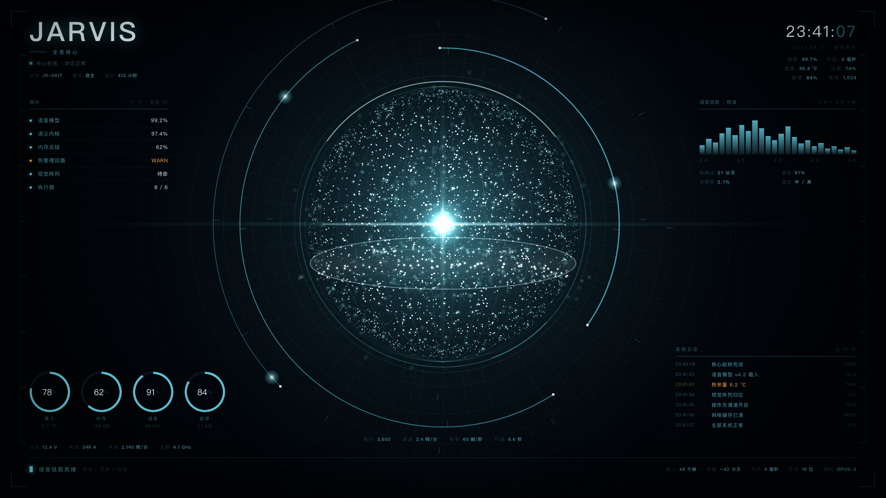
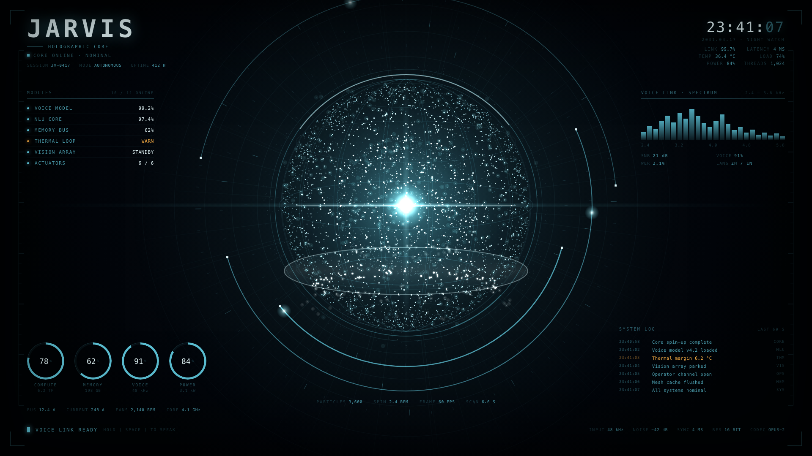
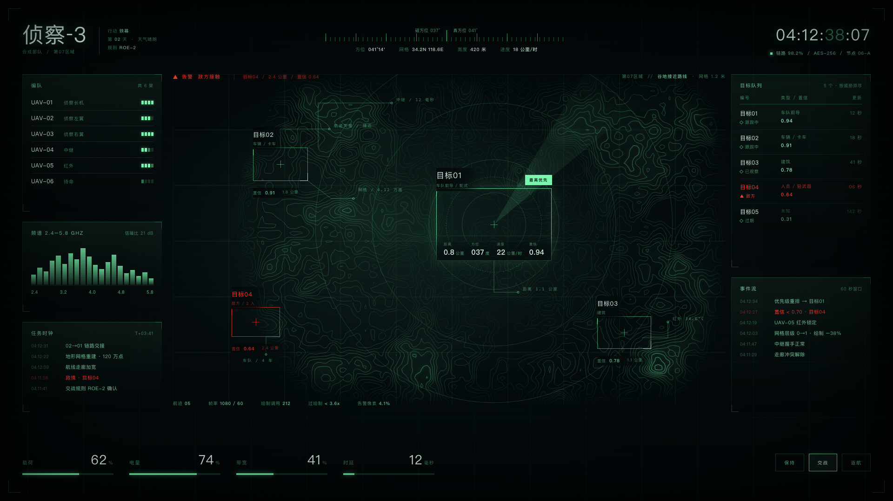
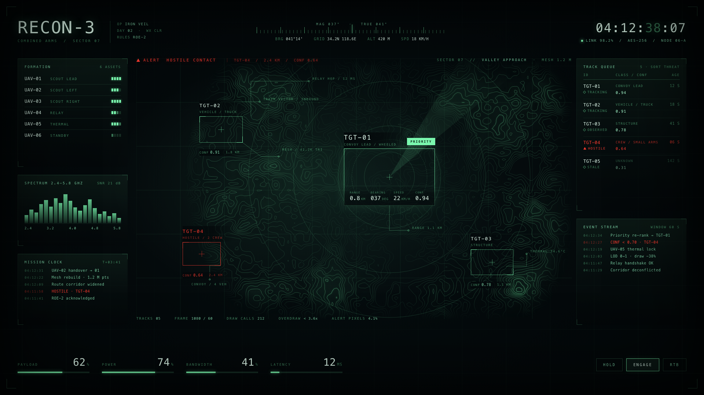
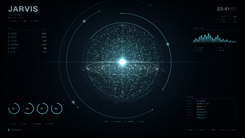
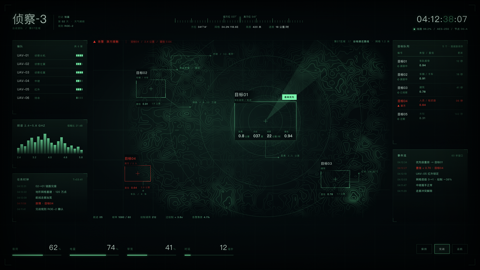

# 开启「人手一个贾维斯（JARVIS）」时代的第一步

> 纯 Markdown 的 HUD / FUI 设计技能包：设计、诊断、深潜三件套，附两套中英双语示例。装进任何能读 `SKILL.md` 的 Agent 即可用，不生成图片、不调 API。

## HUD Design Skills — 给任何 Agent 的 HUD / FUI 设计能力

三个独立技能，装进你的 Agent 就能用：从零设计一套 HUD、诊断已有界面的毛病、按层深潜到某一处细节。方法来自对成熟 HUD 成品画面的逐段拆解，不是凭感觉写的设计清单。

- 不生成图片、不写代码、不依赖任何 API。
- 全部是纯 Markdown + 一个语言探测脚本，任何支持 `SKILL.md` 的 Agent 都能读。
- 所有阈值都标明是「工程约定」，不是片子里的实测数据，换平台可重新标定。

## 包里有什么

```
hud-design/               从零设计：七层流程 + 8 份交付物
├── SKILL.md
└── scripts/
    ├── detect-language.sh        macOS / Linux / WSL / 鸿蒙 / Git Bash
    └── detect-language.ps1       原生 Windows（cmd / PowerShell）
hud-audit/                诊断优化：六轴审计 + P0/P1/P2 修复单
├── SKILL.md
└── scripts/
    ├── detect-language.sh        macOS / Linux / WSL / 鸿蒙 / Git Bash
    └── detect-language.ps1       原生 Windows（cmd / PowerShell）
hud-deep-dive/           按层深潜 + 适用条件
├── SKILL.md
├── scripts/
│   ├── detect-language.sh
│   └── detect-language.ps1
└── references/
    ├── glossary.md                 术语与口径
    ├── cheatsheet.md               七条一句话规则
    └── capabilities/               7 张能力卡
        ├── hud-design.md           设计全流程（摘要）
        ├── hud-audit.md            诊断优化（摘要）
        ├── layout-grammar.md       屏幕分区与空间语法
        ├── information-hierarchy.md 信息分层与数据密度
        ├── visual-language.md      色彩、字体与发光
        ├── motion-choreography.md  动效编排
        └── diegetic-integration.md 实拍 / 引擎内嵌
示例/                       两套方向相反的成品，各出中英两版
├── 贾维斯全息核心/          径向：粒子球 + 三段弧，运行时双语
│   ├── hero.html          单文件，?lang=zh / en
│   └── screenshots/       成图与 25% 缩略
└── 战术态势HUD/            分区：地形 + 锁定框，编译双语
    ├── hero.html          英文版（单一源文件）
    ├── hero-zh.html       中文版（由 build-zh.py 生成）
    ├── build-zh.py        文案映射，改一处两版同步
    └── screenshots/
```

| 技能 | 一句话 | 触发场景 |
|---|---|---|
| `hud-design` | 先定 3 条决策问题，再分区、分层、建组件库、排动效、做验收 | 设计一个新的 HUD / FUI / 数据大屏 / 驾驶舱 / AR 叠加 |
| `hud-audit` | 六轴审计，按读取效率排优先级，出可执行的修复单 | 界面太乱、看不清、太花、上线前走查 |
| `hud-deep-dive` | 一次只加载一张能力卡，解决某一层 | 只改配色 / 只排布局 / 只调动效，或想查某个做法的适用条件 |

三个的关系：design 建房、audit 修房、collection 提供图纸与出处。design 与 audit 是独立入口，collection 是路由，不要三个一起上。

## 安装

把三个目录整体拷到 Agent 的技能目录，**目录名不要改**——`SKILL.md` 的 `name` 必须与目录名一致。

```bash
# Claude Code
cp -R hud-design hud-audit hud-deep-dive ~/.claude/skills/

# 豆包工作区
cp -R hud-design hud-audit hud-deep-dive \
  "$HOME/Library/Application Support/Doubao/Default/.doubao/agent_mode/workspace/.user_skills/"
```

装好后直接说人话即可触发，例如「帮我设计一个深海潜水器的舱内 HUD」「这是我们的游戏 HUD 截图，玩家说太乱」。

## 怎么用

1. **还没有界面** → `hud-design`。它会先要 6 项输入（类型 / 主体 / 任务 / 交付形态 / 运行环境 / 约束），答不出 3 条用户任务就不开工，这是刻意的。
2. **已有界面要挑毛病** → `hud-audit`。给截图（≥1920 宽）或 10 秒以上的录屏，加上「谁在什么距离看多久」；缺场景只能做视觉层审计，技能会明说。
3. **只改一层** → `hud-deep-dive`。说清你要改布局、配色、动效还是内嵌，它只加载一张卡，不会把整套流程重跑一遍。
4. **验收**：design 看 8 份文件齐不齐、6 项测试过没过；audit 看每条修复是否带「证据 → 影响 → 修法 → 验收」，且 P0 ≤5 条。

## 示例：两套方向相反的成品

同一套规则能出两种气质：一套径向，一套分区。都是 1920×1080、单文件、零外部依赖，中英各一版。

### 一、贾维斯全息核心 / JARVIS Holographic Core

`示例/贾维斯全息核心/` 走径向构图：中央 5,600 粒子的三层球壳，叠球面经纬网格、白核与十字光芒、纵向能量柱；三段弧反向缓转、弧上带扫描头，扫描切面 6.6 秒一轮切过球体。外围铺七块数据模块（模块状态、语音频谱、四环表、总线读数、系统日志、顶栏读数、底栏链路参数），球体包围盒内零文字。双语靠运行时字典切换（`?lang=zh` / `en`，缺省按系统语言）。





### 二、战术态势 HUD / Tactical Situation

`示例/战术态势HUD/` 走分区构图：中央地形等高线与四个锁定框，左轨编队与频谱，右轨目标队列与事件流。中文版由 `build-zh.py` 从英文版编译，两份布局不会各自漂移。动效由一层确定性脚本注入：雷达 4 秒扫一圈、四个锁框各自漂移、6.2 秒时 TGT-04 升级为红色告警，全部由时间推导，可逐帧定格导出。





两套缩到 25% 再各看一眼——结构还在，细节主动放弃：





### 同一张验收表

| 测试 | 全息核 | 战术屏 |
|---|---|---|
| 3 秒测试（缩 25% 看 3 秒） | 认出「AI 核心」，球体与扫描面都在 | 认出「无人机集群 · 战场指挥」，主目标与告警都在 |
| 灰阶 | 球壳 / 弧 / 面板三层可分 | 正文 / 次要 / 背景三层可分 |
| 强调色占比 | 琥珀仅「热余量」一条，≈0.4% | 红仅 TGT-04 与告警条，4.1% |
| 中央净空 | 球体包围盒内零文字 | 中区无文字，锁定框内只有指标 |
| 叠层 | 极坐标网格 / 粒子 / 控件 = 3 | 细网格 / 地形 / 控件 = 3 |
| 并发动效 | 球转 + 弧转 + 扫描 = 3 | 雷达扫掠 + 锁框漂移 + 告警升级 |
| 语言一致性 | 每版一种自然语言，机器标识除外 | 同 |

复现（任意无头浏览器，不依赖字体与 CDN）：

```bash
# 全息核：动画画面，必须给虚拟时间预算
cd 示例/贾维斯全息核心
"/Applications/Google Chrome.app/Contents/MacOS/Google Chrome" --headless=new \
  --window-size=1920,1080 --force-device-scale-factor=1 --virtual-time-budget=1600 \
  --screenshot=screenshots/jarvis-1920x1080-zh.png "file://$PWD/hero.html?lang=zh"

# 战术屏：改完英文版后重新生成中文版
cd ../战术态势HUD
python3 build-zh.py
```

## 界面显示语言：先探测，再动手

默认不让模型猜，跑一句就得到结果：

```bash
bash scripts/detect-language.sh     # 输出 zh-CN / zh-TW / en
```

| 探测结果 | HUD 显示语言 | 排版随之变 |
|---|---|---|
| `zh-CN` | 简体中文 | 不加大字距（宽字距会把汉字拆散）；字号地板 +1px；单位用中文词（公里/秒、毫秒、%）；全大写规则不适用 |
| `zh-TW` | 繁體中文 | 同上，繁体字形与台港用词 |
| `en` | English | 全大写 + 字距 0.1–0.2em；单位用 SI 缩写（km/s、ms、%） |

优先级：**用户显式指定 > `HUD_LANG` 环境变量 > 系统界面语言 > `en`**。

- 系统覆盖：macOS（`AppleLocale`）· Windows（Git Bash / MSYS2 走 `Get-Culture`，原生 cmd / PowerShell 用 `scripts/detect-language.ps1`）· Linux（`LC_ALL` / `LANG` / `LANGUAGE` / `/etc/locale.conf` / `localectl`）· WSL（借用 Windows 区域）· 鸿蒙与 OpenHarmony（`param get persist.sys.locale`）。
- 只翻译给人看的文字（标题、状态词、告警词、单位、图例、按钮）；不翻译代码标识符、API 字段名、文件路径、品牌名、`task_id` 这类机器标识。
- 硬规则：**同一块屏只允许一种自然语言**。中英混排只保留机器标识与专有名词（`HUD`、`FUI`、`HEADER 273`）。混排不是风格问题，audit 里记 P1。

## 风格列表

| # | 风格 | 主色相 | 告警色 | 介质痕迹（≤3） | 适用场景 | 主要风险 |
|---|---|---|---|---|---|---|
| 1 | 数据之美 Data Cyan | 青 `#00E5FF` | 橙 | 细网格、扫描线、数值滚动 | 数据大屏、遥测、指挥中心 | 满屏数字显得「假专业」 |
| 2 | 生物医疗 Bio Green | 绿 `#3DFFA0` | 橙 | 有机曲线、细胞噪点、脉动 | 医疗监护、生化、生命体征 | 绿色滥用会稀释「正常」语义 |
| 3 | 工业琥珀 Industrial Amber | 琥珀 `#FFB648` | 红 | 硬件纹理、警示条纹、磨损 | 工厂、能源、机械、舰船 | 亮度不足时像老旧监控 |
| 4 | 军事战术 Tactical | 青绿 `#7CFFB2` | 红 | 目标锁定框、坐标网格、噪点 | 军用、无人机、战术地图 | 装饰过度被误读为「战斗状态」 |
| 5 | 赛博霓虹 Cyber Neon | 洋红 `#FF2D95` + 青 | 黄 | 故障色差、扫描线、残影 | 概念片、游戏界面、品牌炫技 | 发光过量糊字、overdraw 超预算 |
| 6 | 极简单色 Mono | 单色低亮度 | 仅一处 | 无（或极轻噪点） | 标题屏、片头、克制型 FUI | 层次不够就变成「没做完」 |
| 7 | 航天航空 Aerospace | 青或绿 | 红 | 抬头刻度、准星、反光 | 飞行 HUD、航天器、模拟器 | 刻度密度过高，3 秒读不完 |
| 8 | 游戏运行时 Game Runtime | 按世界观 | 红 | diegetic 反光、倾斜、遮挡 | 游戏内 UI、AR 叠加 | 屏幕态与实拍态混用显假 |
| 9 | 转播纪实 Broadcast | 中性白/蓝 | 红 | 无发光、扁平 | 赛事转播、新闻包装、纪录片 | 硬套深底发光会失去可信度 |

选风格的口径：**先看场景亮度与观看距离，再看世界观**。户外强光、车载白天、政务公开屏一律走 9，不走 1–5。

## 各风格的一套提示词

整段复制即可；末尾 `界面显示语言` 留空则由技能自动探测。

| 风格 | 提示词 |
|---|---|
| 数据之美 | 用 hud-design 做一套数据遥测 HUD。风格：数据之美，主色相青、告警橙、深底；三级亮度 100/55/22，关键值最大最亮；五功能区，中央净空 ≥35%；介质痕迹只用细网格、扫描线、数值滚动三种；进入 0–400ms 画框→错峰→滚动→锁定，常态 2–4s 低幅呼吸；告警用颜色+形状+文字三重编码。界面显示语言： |
| 生物医疗 | 用 hud-design 做一套生命体征 HUD。风格：生物医疗，绿色主色相、橙色只用于 ANOMALY；环形仪表+波形+编号三层；关键项 ≤5；绿色不得用于装饰；介质痕迹限有机曲线、细胞噪点、脉动三种；状态动画 120–240ms。界面显示语言： |
| 工业琥珀 | 用 hud-design 做一套设备运维 HUD。风格：工业琥珀，琥珀主色相、红色仅用于越界；仪表盘读数为主、表格行为辅；保留硬件纹理与警示条纹；亮度要够，不做满屏发光；空/载入/失败/越界四态齐备。界面显示语言： |
| 军事战术 | 用 hud-design 做一套战术态势 HUD。风格：军事战术，青绿主色相、红色警戒；左轨目标列表、中央地图+锁定框、右轨遥测；坐标网格与噪点作介质痕迹；锁定框只在选中/威胁时出现；禁止装饰性红色。界面显示语言： |
| 赛博霓虹 | 用 hud-design 做一套概念片 HUD。风格：赛博霓虹，洋红+青双色相、黄色仅提示；扫描线与故障色差作介质痕迹，色差 ≤2px、扫描线透明度 ≤10%；发光只做描边与 bloom，不满屏；叠层 ≤4；交付时标注「影视概念，非真实数据产品」。界面显示语言： |
| 极简单色 | 用 hud-design 做一套片头标题 FUI。风格：极简单色，低亮度单色细字、几乎无发光；只保留标题、时间码、一处告警；不堆仪表，靠留白与字距立层次；英文全大写，中文用窄字距。界面显示语言： |
| 航天航空 | 用 hud-design 做一套飞行抬头显示。风格：航天航空，青或绿主色相、红色警戒；中央准星+地平线+速度/高度刻度；刻度分级显示，避免 3 秒读不完；反光与刻度作介质痕迹；关键值 25% 缩略仍可读。界面显示语言： |
| 游戏运行时 | 用 hud-design 做一套游戏内 HUD。风格：游戏运行时，按世界观定色、红色为危险；采用 diegetic 模式，给反光/倾斜/遮挡三种物理痕迹；血条、弹药、小地图常驻 ≤7 项；状态动画 ≤240ms，强调只出现一次。界面显示语言： |
| 转播纪实 | 用 hud-design 做一套赛事转播包装。风格：转播纪实，中性白/蓝、红色仅用于结果；不做深底发光与扫描线；大字号、高对比、扁平；数据只在边角，中央画面净空。界面显示语言： |

## 统一提示词模板

**设计（hud-design）**

```
请用 hud-design 做一套 HUD。
风格：XXX
界面显示语言：XXX
项目类型：XXX（影视镜头 / 游戏运行时 / 实时可视化 / 工业大屏 / 车载 / AR）
主体：XXX
三条任务：1) XXX  2) XXX  3) XXX
交付形态：XXX（静态单屏 / 动态镜头 / 可交互运行时）
运行环境：XXX（分辨率 / 观看距离 / 引擎或合成软件 / 是否移动端）
约束：XXX（品牌 / 世界观 / 安全法规）
```

**诊断（hud-audit）**

```
请用 hud-audit 审这套 HUD。
界面显示语言：XXX
材料：XXX（截图 ≥1920 宽 / 录屏 ≥10s / 可运行构建）
场景：XXX（谁、在什么环境、什么距离、看多久）
必须支撑的任务：XXX
约束：XXX
```

**深潜（hud-deep-dive）**

```
请用 hud-deep-dive 深潜一层。
界面显示语言：XXX
要解决的问题：XXX（布局 / 层级 / 视觉 / 动效 / 实拍集成）
已有条件：XXX
期望产出：XXX
```

留空规则：`界面显示语言` 留空即自动探测；`风格` 留空由技能按场景推荐并说明理由；其余字段留空会被追问，不会静默默认。

## 不能做的列表

| 不能做 | 为什么 | 该改成 |
|---|---|---|
| 普通 App / 官网 / SaaS 后台 | 信息结构不同，硬套得到「很科幻但没人会用」的界面 | 常规产品 UI 规范 |
| Logo / 海报 / 品牌 VI / 平面排版 | 不在能力域内，风格语言也不通用 | 平面设计流程 |
| 用编造数据撑「专业感」 | 影视可接受，但不能标称「数据产品设计」 | 标注「影视概念，非真实数据产品」 |
| 跳过「三条任务」直接配色发光 | 素材全是完成品，看不到「没想清楚就开画」的代价 | 先答出状态/动作/风险，答不出不开工 |
| design 与 audit 混用 | 会得到既像重做又像批评的四不像 | 已有界面先 audit，决定重做再 design |
| 户外强光 / 车载白天 / 政务屏用深底发光 | 亮度与法规都不允许 | 高对比浅底 + 另做可用性评估 |
| 把告警色当装饰 | 告警语义被稀释，真出事时没人看得见 | 装饰改低饱和同色相，红色只留语义位 |
| 满屏 bloom / 多层半透明叠加 | 糊字 + overdraw 超预算 | 叠层 ≤4，发光只做描边 |
| 红绿方案不加形状 / 文字冗余 | 色觉障碍下不可用 | 颜色 + 形状 + 文字三重编码，或改蓝橙 |
| 把「深色 + 青色」当万能公式 | 工业 / 转播 / 纪实各有成熟语言 | 按场景亮度与观看距离选风格 |
| 无场景与任务就下「可用性结论」 | 只能证明审美，证明不了可用 | 明说「仅视觉层审计」 |
| 用影视审美替代可用性 | 电影里 2 秒有效的横幅，工具里要常驻可查 | 按任务读取效率排序 |
| 默认整体重做 | P0 ≤3 时重做是浪费 | 优先局部修复，重做要给成本与风险 |
| 评作品版权 / 美术风格归属 | 只审设计与工程 | 不做艺术评判 |
| 要 AE / C4D / UE 按钮级教程 | 素材里没有软件教程 | 查软件官方文档 |
| 同屏混排中英（机器标识除外） | 读取效率下降，最常见的低级错 | 统一一种自然语言 |
| 出临床 / 驾驶安全 / 法规合规结论 | 需要专业评估 | 转专业可用性评估 |

## 设计口径（七条）

1. 分区先于装饰：五功能区，中央净空 ≥35%，主体包围盒内不放字。
2. 三层亮度：环境 20–25% / 上下文 45–55% / 关键 90–100%，关键项 ≤5。
3. 单色相 + 单告警色：告警三重编码，告警色像素 ≤5%。
4. 密疏并置：密区只在边缘，中央托主体，密区必须有标题与分隔。
5. 动效四件事：进入、状态、常态、强调；强调只做一次，之后静止。
6. 三种 HUD：screen / world / diegetic 三选一，diegetic 至少 3 种物理痕迹。
7. 能改得动才算交付：8–12 个参数化 widget + token + 引擎内真机测试。

## 来源与局限

- **来源**：方法与阈值来自对公开可得的 HUD / FUI 成品影像的观察归纳——抽帧、读画面上的文字与时间点，反推设计规则。
- **做法**：素材无解说、无设计推演，**所有原则都不是原作者原话**，也不代表任何作品的设计文档。
- **阈值是约定**：净空 35%、叠层 ≤4、告警色 ≤5%、时长 120–400ms 等，素材里没有数值，是为可执行而设，需按平台实测校准。
- **场景偏科**：样本偏科幻 / 军事 / 医疗 / 航天；车载、户外、政务、无障碍需另加可用性评估。
- **不含外部素材**：本包不包含任何来自原始影像的画面、切片或字体文件，只做方法研究；`示例/` 下的截图是示例页面自身的渲染结果，不是素材画面。素材中品牌屏与影视道具屏的视觉资产归原制作方。

## 许可

技能文案与脚本以 MIT 许可发布，详见 `LICENSE`。素材影像与视觉资产的版权归原制作方，不在本许可范围内。

本包是独立的方法研究，与任何 UP 主、制作方、品牌方均无隶属或合作关系，未获其授权，也不代表其观点。若相关权利方认为某处引用不当，可联系我们调整或删除。

---

开启「人手一个贾维斯（JARVIS）」时代的第一步：先让界面说清「现在什么状态、下一步做什么、有什么风险」——其余都是装饰。
